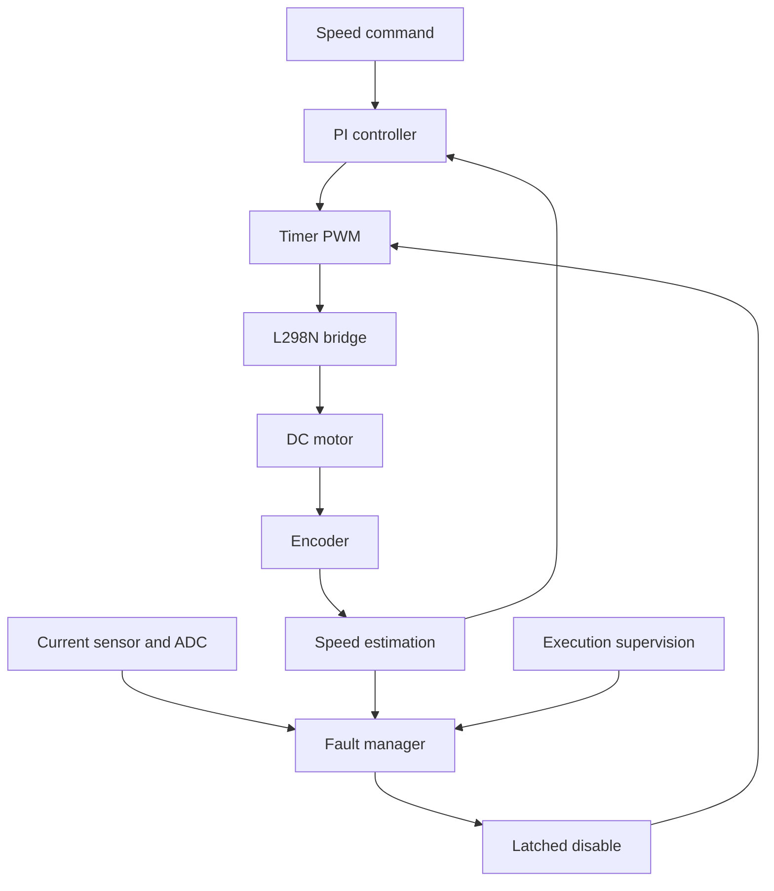

# MotorGuard
### Motor Control & Fault Diagnostics

**Closed-loop speed control · Deterministic shutdown · Measurable verification**

A bench-scale brushed DC motor controller built around the **NUCLEO-F446RE** and **L298N**, with encoder feedback, current monitoring, fault injection, and documented timing measurements.

[Overview](#overview) · [Hardware](#hardware) · [Architecture](#architecture) · [Roadmap](#roadmap) · [Verification](#verification) · [References](#references)

---

## Overview

MotorGuard is an embedded C project for implementing and evaluating a PI speed controller with explicit fault detection and a defined shutdown response. The controller will read a quadrature encoder, acquire motor-current measurements through an ADC, and drive an L298N H-bridge using timer-generated PWM.

Development starts with bare-metal peripheral bring-up. FreeRTOS will then organize supervision and telemetry while the control update retains a measured, fixed-period execution schedule. Verification will connect requirements to fault-injection tests, GPIO timing captures, unit tests, and static-analysis results.

**Current status:** the NUCLEO-F446RE and L298N are available. Firmware, wiring, motor selection, and measurements are planned; this README does not claim completed implementation or passing tests.

### Objectives

- Regulate motor speed using encoder feedback and a PI controller with saturation and anti-windup.
- Monitor current, feedback plausibility, and execution progress.
- Disable the bridge and latch a fault when a defined shutdown condition occurs.
- Measure control-loop jitter, diagnostic overhead, and fault-response latency.
- Detect every applicable fault case in a declared injection campaign, with documented limitations.
- Maintain traceability between hazards, requirements, diagnostics, and verification evidence.

### Scope and terminology

The initial architecture is **fail-safe motor control**: a detected fault causes shutdown. Continued motor operation after a fault, redundant actuation, and certified functional safety are outside this first version.

The STM32F446RE does not provide Hercules eQEP, N2HET, ESM, lockstep CPU diagnostics, or hardware Flash/SRAM ECC. STM32 timer encoder mode and PWM replace the motor-control peripherals. Flash CRC, software RAM tests, watchdogs, and plausibility checks are separate diagnostic mechanisms—not equivalent substitutes for lockstep or ECC.

## Hardware

| Component | Status | Purpose / selection criteria |
| --- | --- | --- |
| NUCLEO-F446RE | Available | MCU, ADCs, timers, onboard ST-LINK debugging |
| L298N driver | Available | H-bridge; confirm exact module, cooling, jumpers, and current capability |
| Brushed DC motor | To confirm | Record rated voltage, no-load speed, rated current, and stall current |
| Quadrature encoder | To confirm | A/B feedback; record supply, output type, counts, and mounting location |
| Analog current sensor | Required for current diagnostics | ADC-compatible output and suitable bandwidth, range, and PWM behavior |
| Current-limited motor supply | To confirm | Sized for the selected motor and driver |
| Multimeter | To confirm | Power and wiring checks |
| Oscilloscope / logic analyzer | To confirm | PWM, encoder, GPIO markers, and shutdown measurements |
| Mount, fuse, disconnect, wiring | To confirm | Secure bench setup and repeatable tests |
| External comparator / shutdown logic | Later extension | Hardware overcurrent shutdown independent of normal software execution |

### L298N integration notes

- Match the motor to the actual board's thermal and current limits; do not treat a module's advertised peak rating as continuous capability.
- Account for bridge voltage drop and heating. The L298 datasheet lists approximately 1.8 V typical total saturation drop at 1 A.
- Its TTL-compatible inputs accept 3.3 V control signals under the specified operating conditions.
- If the module has an ENA jumper tying enable high, remove it before connecting PWM. Use an approximately 10 kΩ ENA pull-down and verify the disabled state during reset and programming.
- ENA low disables the bridge. It does not stop rotor motion or eliminate winding current instantaneously.
- Confirm the module's logic-supply/regulator jumper behavior before connecting power. Keep the motor on an external supply, establish a common signal ground, and never connect the module's 5 V terminal to the MCU's 3.3 V rail.
- Check current-sense pin accessibility. If the board ties the chip's sense pins directly to ground, use a separate sensing circuit rather than assuming current feedback is available.
- Verify flyback-diode provision on the module; a bare L298 requires the external components specified in its application circuit.

### Proposed signal allocation

Exact GPIO pins and alternate functions will be assigned in STM32CubeMX after checking the Nucleo headers and module wiring.

| Signal | Proposed peripheral / connection |
| --- | --- |
| L298N ENA | TIM1 PWM output, configured to become low on shutdown |
| L298N IN1 / IN2 | Two GPIO outputs; direction changes interlocked with disable |
| Encoder A / B | TIM2 or TIM3 in encoder interface mode |
| Current-sense output | ADC input with suitable conditioning and protection |
| Control update | Dedicated periodic timer event |
| Telemetry | UART through the board's virtual COM connection |
| Timing markers | Separate GPIOs for control execution and fault-handler entry |
| Optional hardware trip | External comparator or fault logic to TIM1 break input |

Encoder voltage levels must be checked against the selected pins. Keep analog inputs within their specified range; digital-pin tolerance does not imply ADC tolerance.

## Software and tools

| Tool | Role |
| --- | --- |
| STM32CubeIDE | Build, flash, debug, and inspect registers |
| STM32CubeMX + STM32CubeF4 | Pin/clock configuration, initialization, HAL/LL drivers, and examples |
| FreeRTOS | Planned supervision, telemetry, and task-health monitoring |
| Git | Version firmware, configuration, requirements, and evidence |
| Python, pyserial, plotting libraries | Test orchestration, telemetry capture, and response plots |
| Unity / CMock; optional Ceedling | Host tests for portable application logic |
| Cppcheck with MISRA addon | Initial static analysis against the selected MISRA C:2012 rule set |
| Serial terminal | Bring-up logs and controlled commands |

Record compiler, IDE, driver, and RTOS versions with each measured release. A static-analysis pass alone does not establish MISRA compliance; document uncovered rules, manual reviews, and deviations.

## Architecture

### Control and execution

- Start with a proposed **1 kHz PI update** and **5 kHz PWM** for bench bring-up. These are initial settings, not validated requirements; adjust for encoder resolution, motor response, driver losses, and measured timing.
- Estimate speed from encoder-count differences over a known sample interval. Record whether encoder resolution means pulses per channel or counts after quadrature decoding, and account for gearbox ratio and counter wraparound.
- Limit output to the allowed duty-cycle range. Apply anti-windup, a setpoint ramp, and integrator reset on disable/fault.
- Begin with one-direction control. Add bidirectional operation only after defining safe reversal and current limits.
- Keep the control computation bounded. Use a timer ISR or a timer-released high-priority task, then measure its deadline behavior.
- Run logging and noncritical diagnostics at lower priority. Keep blocking I/O out of the control and fault-response paths.
- Refresh the watchdog only after checking required execution progress, rather than from an unconditional periodic interrupt.

### Operating states

| State | Behavior | Exit condition |
| --- | --- | --- |
| BOOT | ENA held low; initialize and run startup checks | Checks pass or a fault is latched |
| READY | Bridge disabled; accept configuration and arm command | Valid explicit arm request |
| RUN | Execute speed control and active diagnostics | Stop command or fault |
| FAULT_LATCHED | Disable bridge; reset PI integrator; preserve fault information | Cause cleared and explicit rearm/reset accepted |

Boot, watchdog reset, and fault recovery must never automatically restart the motor. The first prototype defines its safe state as **bridge disabled, restart inhibited, and fault recorded**. This permits coasting and must be reconsidered for loads that require braking or holding torque.

## Roadmap

| Phase | Work | Exit evidence |
| --- | --- | --- |
| 0 — Define the bench | Identify motor and encoder; inspect L298N; select sensing; write wiring and limits | Reviewed pin map, power plan, and initial requirements |
| 1 — Bring up outputs | Build firmware; UART logs; PWM; direction GPIOs; reset-safe ENA | Scope captures showing PWM and disabled output during reset |
| 2 — Read feedback | Encoder direction/counts; wraparound; current ADC calibration | Measured counts, speed calculation, current calibration data |
| 3 — Close the speed loop | PI, anti-windup, setpoint ramp, stop/restart logic | Speed-step plots at declared speeds and loads |
| 4 — Add diagnostics | Fault manager, watchdog, plausibility checks, current threshold, startup checks | Basic fault tests and documented state transitions |
| 5 — Integrate FreeRTOS | Task separation, health checks, priorities, bounded telemetry | Jitter and response measurements under representative load |
| 6 — Run the campaign | Automated injections, unit tests, static analysis, traceability | Completed matrix with pass/fail results and evidence links |
| 7 — Extend protection | Optional hardware trip; repeat tests and review limits | Hardware-trip timing and independent shutdown demonstration |

### Immediate checklist

- [ ] Identify motor voltage, stall current, encoder interface, and resolution.
- [ ] Confirm L298N module wiring, ENA jumper, regulator configuration, and diode provision.
- [ ] Create the STM32CubeIDE project and commit its CubeMX configuration.
- [ ] Verify default-low ENA with motor power disconnected.
- [ ] Generate PWM and confirm an immediate forced-disable path on the bench.
- [ ] Run the motor at limited power, then verify encoder direction and speed.
- [ ] Add current sensing before active overcurrent tests.

## Verification

### Timing definitions

The original Hercules ESM timing objective is adapted to the STM32 fault path:

| Metric | Measurement | Initial criterion |
| --- | --- | --- |
| Software shutdown latency | Fault-handler entry marker → ENA low and held low | Target ≤ 50 μs for designated interrupt-driven cases |
| End-to-end response | Defined injection/event marker → bridge disable | Measure and report separately for each fault class |
| Hardware-trip response | External trip signal → PWM inactive / bridge disabled | Characterize after hardware trip is implemented |
| Control execution and jitter | GPIO pulses around control execution and periodic releases | Complete before the next selected control deadline |
| Diagnostic overhead | Execution measurements with diagnostics enabled vs. disabled | Report absolute time and percentage under the same conditions |

The 50 μs objective is a **target, not a measured result**. It excludes fault-detection time when measured from handler entry. Encoder timeouts, watchdog expiry, filtering, and debounce have their own intervals. A GPIO marker is an approximation to software entry, so document instrumentation overhead.

Test across PWM phases and representative interrupt/RTOS load. Do not rely solely on writing a zero duty cycle: timer preload can defer the update. Configure and verify a path that forces ENA inactive immediately. Validate the driver response as well as the MCU signal; a low ENA does not prove zero winding current or a stopped shaft.

### Initial fault-injection matrix

All cases below are planned. Use bounded software hooks and signal fixtures first; physical electrical-fault tests require a defined procedure and suitable bench limits.

| ID | Injected case | Expected detection | Expected response | Evidence |
| --- | --- | --- | --- | --- |
| FI-01 | Remove encoder pulses during commanded motion | Feedback timeout qualified by command and operating state | Latched disable | Pulse trace, timeout log, ENA capture |
| FI-02 | Feed an excessive or inconsistent count sequence | Speed/direction plausibility check | Latched disable | Injected sequence and fault record |
| FI-03 | Inject a current sample above the configured threshold | Current threshold logic / ADC monitoring path | Latched disable | Sample log and shutdown timing |
| FI-04 | Apply a bounded sensor out-of-range signal | Range/plausibility diagnostics where observable | Latched disable | ADC readings and fault record |
| FI-05 | Stall the control task while supervision remains active | Missing progress/deadline check | Disable, then controlled recovery/reset policy | Task trace and ENA capture |
| FI-06 | Stop valid watchdog servicing | IWDG expiry | Reset with ENA remaining low; no automatic restart | Reset cause and reset-time ENA trace |
| FI-07 | Service WWDG outside the configured window | Window watchdog | Reset with restart inhibited | Reset-cause log |
| FI-08 | Corrupt a dedicated test buffer or test signature | CRC / software memory-check logic | Prevent arming or latch fault | Expected vs. observed checksum/test result |
| FI-09 | Interrupt external clock in a controlled fixture | Clock security system, where configured/applicable | Defined clock-fault disable response | Clock setup, fault record, timing capture |
| FI-10 | Reset MCU during operation | Reset-safe output design | ENA low throughout reset and startup | Scope capture |
| FI-11 | Load CPU and telemetry paths | Timing instrumentation / deadline monitor | Meet deadlines or detect the miss | Worst observed jitter and execution time |
| FI-12 | Assert optional external hardware trip | Timer break / shutdown logic | Force PWM inactive independently of normal tasks | Trip-to-output capture |

An open or shorted sensor is not always distinguishable from a valid reading. Identify undetectable cases explicitly and add biasing, redundancy, or other diagnostics only when required by the stated fault model.

Report campaign detection as **detected applicable cases / executed applicable cases**, with repetitions, detection intervals, exclusions, and failures. Detection of all injected cases is not proof of coverage of all possible hardware faults or a formal safety diagnostic-coverage percentage. Software buffer corruption also does not demonstrate hardware ECC behavior.

### Requirements and traceability

| Requirement | Hazard / concern | Mechanism | Verification |
| --- | --- | --- | --- |
| REQ-01: Motor remains disabled until explicitly armed | Unexpected startup | ENA pull-down, startup checks, state machine | FI-06, FI-07, FI-10; arm/rearm tests |
| REQ-02: Invalid speed feedback causes shutdown | Uncontrolled speed command | Qualified timeout and plausibility checks | FI-01, FI-02 |
| REQ-03: Excessive measured current causes shutdown | Excessive electrical/thermal stress | Calibrated sensing and threshold logic | FI-03, FI-04; bounded sensor-path tests |
| REQ-04: Designated fault handlers force ENA low within 50 μs | Prolonged actuation after detection | Immediate output-disable path | Timing captures for applicable interrupt cases |
| REQ-05: Loss of execution progress cannot cause automatic restart | Stalled controller / reset loop | Health-gated watchdog and boot interlock | FI-05, FI-06, FI-07 |
| REQ-06: Control updates meet the selected period | Unstable or inconsistent response | Bounded computation and scheduling | FI-11; GPIO timing analysis |
| REQ-07: Each result is reproducible | Unsupported performance claims | Versioned configuration and evidence | Review campaign records |

### Unit tests and analysis

- PI saturation, anti-windup, integrator reset, and setpoint limiting.
- Encoder count rollover, direction, scaling, and timeout boundaries.
- Fault latching, priority, rearm conditions, and state transitions.
- ADC scaling, threshold boundaries, and plausibility behavior.
- Task-health decision logic and watchdog-service eligibility.

Use host tests for portable logic and target tests for peripherals, interrupts, timing, and physical shutdown. Archive compiler warnings, static-analysis findings, review notes, and justified deviations.

## Planned repository organization

These are proposed locations, not claims that the files already exist.

| Path | Contents |
| --- | --- |
| `firmware/` | CubeIDE project, CubeMX configuration, startup, and peripheral integration |
| `firmware/App/` | Control, speed estimation, diagnostics, state machine, and telemetry |
| `tests/unit/` | Host unit tests and mocks |
| `tests/bench/` | Target procedures and injection cases |
| `tools/` | Python telemetry capture, analysis, and test scripts |
| `docs/requirements.md` | Hazards, scope, limits, and requirements |
| `docs/hardware.md` | Wiring, motor specifications, power, and sensing |
| `docs/fault-matrix.csv` | Executed cases, expected outcomes, results, and evidence paths |
| `results/` | Versioned logs, scope captures, plots, and timing reports |

## Completion criteria

- [ ] Demonstrate closed-loop operation and document the tested speed/load range.
- [ ] Record speed accuracy, overshoot, settling behavior, and saturation behavior; define acceptance limits before final validation.
- [ ] Verify shutdown and restart inhibition for every applicable case in the declared campaign.
- [ ] Measure the 50 μs target for designated fault-handler paths and report end-to-end response separately.
- [ ] Verify ENA remains low during boot, reset, debugger activity, and rearm handling.
- [ ] Complete unit tests and review static-analysis findings.
- [ ] Link each safety-related requirement to evidence and disclose remaining limitations.

## References

- [STM32F446RE product information](https://www.st.com/en/microcontrollers-microprocessors/stm32f446re.html)
- [STM32F446 datasheet](https://www.st.com/resource/en/datasheet/stm32f446re.pdf)
- [RM0390: STM32F446 reference manual](https://www.st.com/resource/en/reference_manual/dm00135183.pdf)
- [NUCLEO-F446RE board information](https://www.st.com/en/evaluation-tools/nucleo-f446re.html)
- [L298 datasheet](https://www.st.com/resource/en/datasheet/l298.pdf)
- [STM32CubeF4 firmware package](https://github.com/STMicroelectronics/STM32CubeF4)
- [Unity, CMock, and Ceedling](https://www.throwtheswitch.org/)
- [Cppcheck MISRA addon documentation](https://github.com/cppcheck-opensource/cppcheck/blob/main/addons/README.md)

Use the exact MCU/package documentation, silicon errata, board revision, and driver-module schematic when finalizing the implementation.

---

**Build the controller. Inject the fault. Measure the response.**

